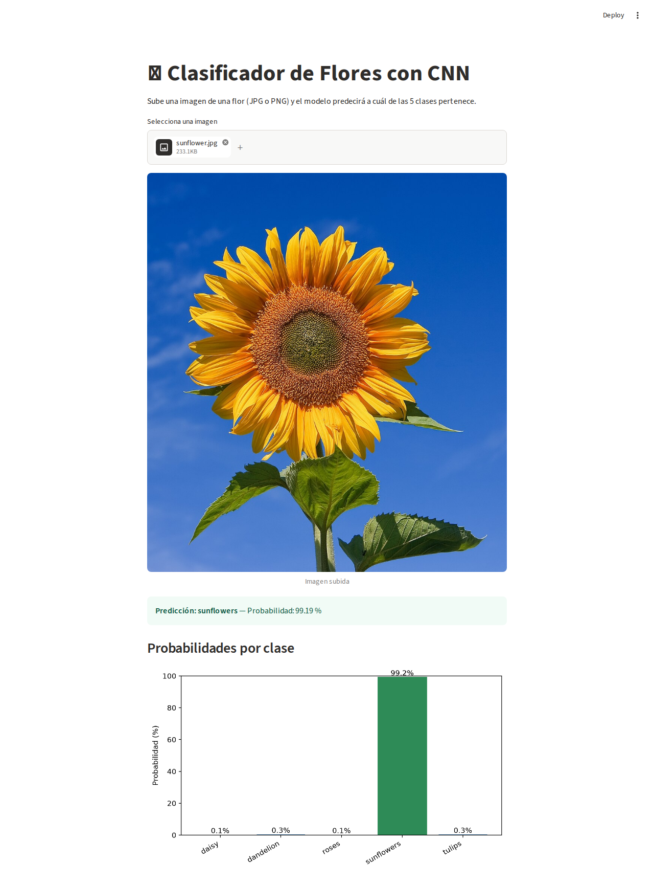

# Clasificador de Flores con CNN y Streamlit

Proyecto de clasificación de imágenes con una red neuronal convolucional
construida en **Keras/TensorFlow**, desplegada como aplicación web con
**Streamlit**.

## 📝 Descripción del proyecto

El objetivo del proyecto es entrenar una CNN que identifique a qué clase de
flor pertenece una imagen. El flujo de trabajo es el siguiente:

1. El modelo se entrena en **Google Colab** (el notebook está en `notebooks/`)
   y se exporta como `models/flowers_cnn.keras`.
2. La app de Streamlit (`app.py`) carga el modelo, recibe una imagen subida por
   el usuario y devuelve la clase predicha con su probabilidad, además de un
   gráfico de barras con las probabilidades de todas las clases.
3. También existe un script de línea de comandos (`predict.py`) para hacer
   predicciones desde la terminal.

> El modelo incluye una capa `Rescaling` interna, por lo que las imágenes de
> entrada solo se redimensionan a 160x160 en RGB, **sin normalizar**.

## 🌸 Dataset

Se utiliza el dataset de **Flores** con **5 clases**:

| Clase | Descripción |
|---|---|
| `daisy` | Margarita |
| `dandelion` | Diente de león |
| `roses` | Rosas |
| `sunflowers` | Girasoles |
| `tulips` | Tulipanes |

Las imágenes se redimensionan a **160x160 píxeles** en formato RGB.

## 📁 Estructura del repo

```
.
├── app.py                  # App de Streamlit
├── predict.py              # Script de predicción por línea de comandos
├── requirements.txt        # Dependencias del proyecto
├── assets/                 # Imágenes del README (capturas de la app)
│   └── screenshot_app.png
├── notebooks/              # Notebooks (entrenamiento en Google Colab)
├── models/                 # Modelo entrenado (.keras) y nombres de clases (.json)
│   ├── flowers_cnn.keras
│   └── class_names.json
├── .gitignore
└── README.md
```

## ⚙️ Instalación

Se recomienda usar un entorno virtual:

```bash
python -m venv .venv
source .venv/bin/activate      # Linux/macOS
# .venv\Scripts\activate       # Windows

pip install -r requirements.txt
```

## 🚀 Cómo ejecutar la app

```bash
streamlit run app.py
```

Se abrirá el navegador en `http://localhost:8501`. Sube una imagen (JPG/PNG)
de una flor y la app mostrará la clase predicha, su probabilidad y un gráfico
con las probabilidades de todas las clases.

### 📸 Captura de la app



## 🖥️ Cómo usar predict.py

```bash
python predict.py ruta/a/la/imagen.jpg
```

Ejemplo de salida:

```
Clase: sunflowers
Probabilidad: 97.34 %
```

## 📊 Resultados

> **TODO**: Completar esta sección con los resultados del entrenamiento
> (precisión/loss en train y validación, matriz de confusión, ejemplos de
> predicciones, etc.).
